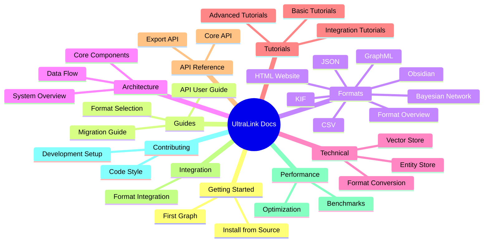

# UltraLink Documentation

Welcome to the official documentation for UltraLink, a JavaScript library for creating, managing, and exporting knowledge graphs. Start with installation and basic usage, or explore the available export formats.

> **Documentation Standard**: All diagrams in the UltraLink documentation use Mermaid syntax for consistency, clarity, and maintainability. This ensures diagrams are both visually appealing and can be properly rendered in various documentation formats.

## What is UltraLink?

UltraLink is a meta-linking paradigm for managing and analyzing relational content with:

- **Flexible rendering system** that transforms knowledge into multiple target formats
- **Deterministic deployment** capabilities
- **Temporal analysis** to track knowledge evolution

Whether you're building a knowledge management system, a research platform, or integrating knowledge graphs into your applications, UltraLink provides the tools and flexibility you need.

## 🔑 Key Differentiator: Flexible Rendering System

The **defining feature** of UltraLink is its exceptionally flexible rendering system. Unlike traditional knowledge graph tools that lock you into specific formats, UltraLink can transform your knowledge into virtually any target format:

- **Standard Formats**: JSON, GraphML, CSV for universal compatibility
- **Knowledge Management**: Obsidian, Wiki formats, Documentation systems
- **Analytical Formats**: Bayesian Networks, KIF, RDF/OWL
- **Interactive Formats**: HTML websites, D3.js visualizations, 3D networks
- **Custom Formats**: Game engines, VR/AR, audio descriptions, and more

This format-agnostic approach means the same knowledge graph can power documentation, visualizations, analysis tools, and interactive applications without duplication or synchronization issues.

**[Learn more about UltraLink's Flexible Rendering System](./core-features/rendering-flexibility.md)**

## Documentation Structure

The documentation is organized into the following sections:



## Main Documentation Sections

### Getting Started

Use Node.js 22.23.5, the version tested for this setup. [Clone the repository and install its dependencies](../INSTALLATION.md#development-setup).

From the repository root, run this example to create two entities, link them, and print the graph as JSON:

```bash
node <<'JS'
const { UltraLink } = require('.');
const graph = new UltraLink();
graph.addEntity('alice', 'person', { name: 'Alice' });
graph.addEntity('project', 'project', { name: 'First Graph' });
graph.addLink('alice', 'project', 'works_on');
console.log(graph.toJSON({ pretty: true }));
JS
```

### [Guides](./guides/README.md)

Comprehensive guides for various aspects of UltraLink:

- [API User Guide](./guides/api-user-guide.md) - Learn how to use UltraLink's API effectively
- [Choosing the Right Format](./guides/choosing-format.md) - Select the appropriate export format for your needs
- [Migration Guide](./guides/migration-guide.md) - Upgrade between versions or migrate between formats

### [Formats](./formats/README.md)

UltraLink supports numerous export formats, each suited for different use cases:

- [JSON Format](./formats/JSON_FORMAT.md)
- [GraphML Format](./formats/GRAPHML_FORMAT.md)
- [CSV Format](./formats/CSV_FORMAT.md)
- [Obsidian Format](./formats/OBSIDIAN_FORMAT.md)
- [HTML Website Format](./formats/HTML_WEBSITE_FORMAT.md)
- [Bayesian Network Format](./formats/BAYESIAN_NETWORK_FORMAT.md)
- [Knowledge Interchange Format (KIF)](./formats/KIF_FORMAT.md)
- [Full Blob Format](./formats/FULL_BLOB_FORMAT.md)
- [Visualization Format](./formats/VISUALIZATION_FORMAT.md)
- [Formats Overview](./formats/FORMATS_OVERVIEW.md)
- [Rendering Targets Overview](./formats/RENDERING_TARGETS.md)

### [Core Features](./core-features/README.md)

Understand UltraLink's core differentiating features:

- [Syntax and Semantics](./core-features/syntax-and-semantics.md) - The fundamental model and syntax of UltraLink
- [Rendering Flexibility](./core-features/rendering-flexibility.md) - The power of UltraLink's format-agnostic approach
- [Temporal Analysis](./core-features/temporal-analysis.md) - Tracking knowledge evolution over time

### [Architecture](./architecture/README.md)

Understand UltraLink's architecture and design principles:

- [Architecture Overview](./architecture/architecture_overview.md)
- [Core Components](./architecture/README.md#core-components)
- [Data Flow Models](./technical/data-flow-models.md)

### [Technical Documentation](./technical/README.md)

Dive into the technical details of UltraLink:

- [Format Conversion](./technical/format-conversion.md)
- [Entity Store](./technical/README.md#entity-store)
- [Vector Store](./technical/README.md#vector-store)

### [Tutorials](./tutorials/README.md)

For a runnable first example, start with [Getting Started](#getting-started) above.

### API Reference

- [Creating Entities](./API_USAGE.md#creating-entities)
- [Data Export Methods](./API_USAGE.md#exporting-data)
- [Temporal API](./api/temporal-api.md)

### [Integration](./integration/README.md)

Guides for integrating UltraLink with other tools and systems:

- [Format Integration Guide](./integration/format-integration.md)

### Performance

Performance considerations and benchmarks:

- [Format Benchmarks](./performance/format-benchmarks.md)
- [Performance Optimization](./advanced/performance.md)

### [Advanced Topics](./advanced/README.md)

Advanced features and use cases:

- [Advanced Query Patterns](./guides/advanced-query-patterns.md)

### [For Agents](./for-agents/README.md)

Documentation for AI agent integration:

- [Agent Integration Guide](./for-agents/agent-integration-guide.md)
- [LLM Compatibility](./for-agents/README.md#llm-compatibility)
- [Prompt Engineering](./guides/prompt-engineering.md)

### [Contributing](../CONTRIBUTING.md)

Guidelines for contributing to UltraLink development:

- [Install from Source](../INSTALLATION.md#development-setup)
- [Code Style](../CONTRIBUTING.md#code-style)

## Additional Resources

- [FAQ](./faq.md) - Frequently asked questions about UltraLink
- [Troubleshooting](./troubleshooting/troubleshooting.md) - Solutions to common issues
- [Community Support](./contributing/community-support.md) - Where to get help from the community

## Latest Updates

See the [changelog](../CHANGELOG.md#unreleased) for recent changes.

## Version Information

This documentation applies to UltraLink version 0.1.x (the version in `package.json`).

## Contributing to Documentation

We welcome documentation improvements. See the [documentation section of the contributing guide](../CONTRIBUTING.md#documentation) for details.

## Documentation Standards

All documentation in this project follows these standards:

1. **Clarity**: Information is presented clearly with appropriate examples.
2. **Comprehensive**: Each topic is covered thoroughly with all relevant details.
3. **Structured**: Documentation follows a consistent structure.
4. **Updated**: Documentation is kept in sync with the codebase.
5. **Accessible**: Documentation is accessible to both beginners and advanced users.
6. **Visual**: Complex concepts are illustrated with Mermaid diagrams for consistency.

## Building the Documentation

The documentation is plain Markdown under `docs/` — there is no build step and
no `docs:build`/`docs:serve` npm script. Read the files directly or render them
with any Markdown viewer.

## Documentation Roadmap

We have the following improvements planned for our documentation:

1. Video tutorials for common tasks
2. Interactive examples embedded in the documentation
3. Translation to additional languages
4. Improved searchability and cross-referencing
5. User-contributed cookbook recipes ]

## Known documentation gaps (docs-audit 2026-08-29)

Intra-doc link audit: 73 distinct relative link targets referenced from
`docs/*.md` do not exist yet (planned pages such as `series/part1-setup.md`,
`api/core-api.md`, `guides/advanced-queries.md`, workshop/tutorial pages).
Case/encoding errors were corrected in place; these remaining targets are
aspirational content gaps, listed for owner follow-up rather than deleted.
