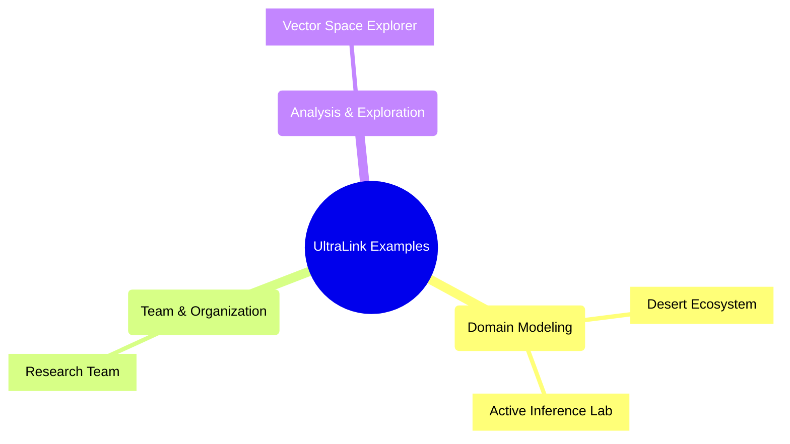

# UltraLink Examples

These written examples illustrate how to model different domains. Some snippets
use proposed or older interfaces and are not runnable as-is. For executable
examples from this checkout, see [Getting Started with Examples](#getting-started-with-examples).

## Overview

| Example | Description | Key Features |
|---------|-------------|-------------|
| [Desert Ecosystem](desert-ecosystem.md) | Model a desert ecosystem with organisms, abiotic factors, and their relationships | Custom entity types, temporal tracking, complex relationships |
| [Active Inference Lab](active-inference-lab.md) | Model a research laboratory with researchers, projects, and publications | Research tracking, collaboration networks, project management |
| [Research Team](research-team.md) | Model a research team's structure, expertise, and project assignments | Expertise mapping, collaboration analysis, skill management |
| [Vector Space Explorer](vector-space-explorer.md) | Create an interactive explorer for semantic analysis | Vector embeddings, dimensionality reduction, similarity analysis |

## Domain Modeling Examples

### [Desert Ecosystem](desert-ecosystem.md)

This example demonstrates how to use UltraLink to model a complex natural ecosystem, including:

- Desert animals with adaptations and behaviors
- Desert plants and survival mechanisms
- Environmental factors and geographical features
- Relationships between organisms and their environment
- Temporal changes in the ecosystem

### [Active Inference Lab](active-inference-lab.md)

This example shows how to model a scientific research laboratory, including:

- Researchers with their expertise and roles
- Research projects with goals and status
- Publications and their connections to researchers
- Experiments and their data
- Conceptual relationships in the research domain

## Team & Organization Examples

### [Research Team](research-team.md)

This example demonstrates how to model and analyze a research team's structure:

- Team members with their roles and expertise
- Project assignments and contributions
- Knowledge domains and expertise distribution
- Collaboration networks and mentorship
- Expertise gaps and team optimization

## Analysis & Exploration Examples

### [Vector Space Explorer](vector-space-explorer.md)

This modeling overview sketches a vector space explorer:

- Vector embeddings for semantic analysis
- Dimensionality reduction techniques (t-SNE, UMAP, PCA)
- Similarity search and clustering
- Interactive 2D and 3D visualizations
- Semantic relationship discovery

## Getting Started with Examples

Follow [Development Setup](../../INSTALLATION.md#development-setup) to clone
this repository and install its dependencies. From the repository root, use
[Rendering Examples](../../examples/README.md#rendering-examples) to run the
bundled renderer for the Desert Ecosystem, Active Inference Lab, Research Team,
and other included datasets. It saves files locally; this index does not host
the rendered outputs.

To build a small graph yourself, start with
[Build your first graph](../README.md#getting-started).

## Extending the Examples

You can use these modeling overviews to plan your own graph. For example, you can:

- Add new entity types to model additional aspects
- Modify the relationships to reflect different domain knowledge
- Extend the visualizations with custom components
- Combine elements from different examples for your specific use case

See the [Contributing Guide](../../CONTRIBUTING.md) for more information on how to contribute new examples or improvements to existing ones. 